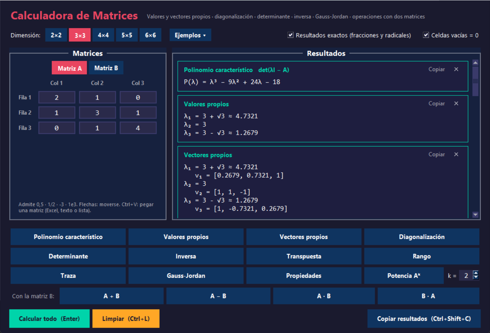
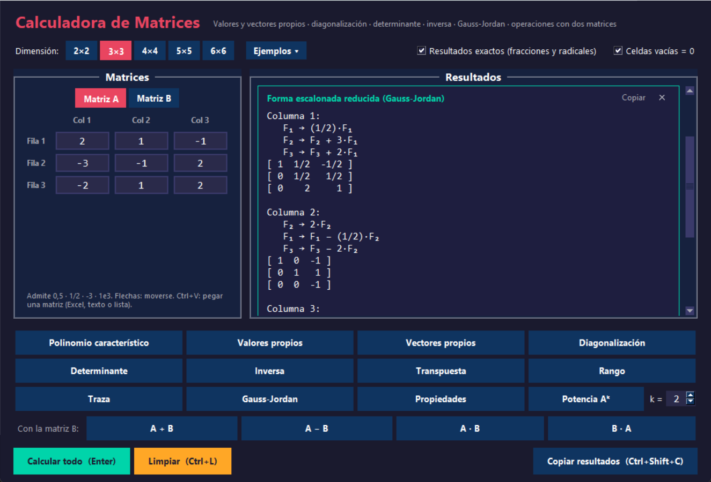

<div align="center">

# Calculadora de Matrices

**Aplicación de escritorio para estudiar álgebra lineal con resultados exactos:
fracciones, radicales y Gauss-Jordan paso a paso.**

[](https://www.python.org/)
[](https://numpy.org/)
[](https://docs.python.org/3/library/tkinter.html)
[](#tests)
[](LICENSE)
[](https://github.com/AcuLuis/CalculadoraMatrices/stargazers)



</div>

---

## Contenido

- [Características](#características)
- [Capturas](#capturas)
- [Instalación](#instalación)
- [Uso](#uso)
- [Estructura del proyecto](#estructura-del-proyecto)
- [Arquitectura](#arquitectura)
- [Tests](#tests)
- [Licencia](#licencia)
- [¿Te resultó útil?](#te-resultó-útil)

---

## Características

### Propiedades de una matriz (de 2×2 a 6×6)

| Operación | Detalle |
|-----------|---------|
| Polinomio característico | P(λ) = det(λI − A) |
| Valores propios | Con su multiplicidad; exactos cuando es posible: `3 + √3 ≈ 4.7321` |
| Vectores propios | Escalados para leerse fácilmente: `[1, 2]` en lugar de `[0.4472, 0.8944]` |
| Diagonalización | A = P·D·P⁻¹, o el motivo por el que no es diagonalizable |
| Determinante, rango y traza | Exactos con fracciones |
| Inversa | En fracciones, con aviso si la matriz está mal condicionada |
| Transpuesta | — |
| Gauss-Jordan | Forma escalonada reducida **paso a paso**, con cada operación de fila |
| Propiedades | Simétrica, antisimétrica, diagonal, triangular, ortogonal, idempotente, invertible, diagonalizable, definida positiva |
| Potencia Aᵏ | Con k entre −10 y 20 (los exponentes negativos usan la inversa) |

### Operaciones con dos matrices

A + B, A − B, A · B y B · A, indicando si A y B conmutan.

### Resultados exactos

Con la opción **Resultados exactos** (activada por defecto), los cálculos se hacen
con fracciones, sin redondeo, y coinciden con los que se obtienen a mano:

- Inversa de `[[1, 2], [3, 4]]` → `[[-2, 1], [3/2, -1/2]]`
- Valores propios de la misma matriz → `(5 + √33)/2 ≈ 5.3723` y `(5 - √33)/2 ≈ -0.3723`

Si alguna fracción resulta demasiado grande para leerse, ese resultado se muestra en
decimales con una nota que lo indica.

### Fiabilidad

- **Comprobaciones visibles** en cada resultado clave: A·v = λ·v, A·A⁻¹ = I y A·P = P·D.
- **Casos especiales bien tratados:** matrices singulares (decididas por el rango, no
  por un umbral fijo del determinante), matrices no diagonalizables y valores propios
  complejos o repetidos.
- **Sin ruido numérico:** nunca muestra `-0` ni `0.30000000000000004`.

### Comodidad

- Acepta `0,5`, `0.5`, `1/2`, `-3/4` y `1e3`.
- **Pega una matriz completa** con Ctrl+V desde Excel, Google Sheets, texto (`1 2; 3 4`)
  o listas de Python (`[[1, 2], [3, 4]]`).
- Los errores se marcan en la propia celda, con su explicación y sin ventanas emergentes.
- Los resultados **se recalculan solos** al editar la matriz.
- Cada resultado se puede copiar, y las matrices copiadas se pueden volver a pegar.
- Ejemplos incluidos: identidad, aleatoria, singular, simétrica, no diagonalizable,
  con valores propios complejos y con fracciones.

---

## Capturas

<div align="center">

**Gauss-Jordan paso a paso con fracciones exactas**



</div>

---

## Instalación

**Requisitos:** Python 3.8 o superior y NumPy 1.20 o superior.

```bash
git clone https://github.com/AcuLuis/CalculadoraMatrices.git
cd CalculadoraMatrices
pip install numpy
python Matrices.py
```

> Tkinter viene incluido con Python en Windows y macOS. En Linux puede requerir
> instalarlo aparte (por ejemplo, `sudo apt install python3-tk`).

---

## Uso

1. Elige la **dimensión** (2×2 a 6×6) en la barra superior.
2. Escribe los valores de la matriz A.
3. Pulsa **Calcular todo** (Enter) o el botón de una operación concreta. Los botones
   individuales agregan su resultado sin borrar los demás.
4. Para operar con dos matrices, escribe B en la pestaña **Matriz B** y usa los botones
   de la fila *Con la matriz B*.

Opciones de la barra superior:

- **Resultados exactos:** fracciones y radicales (activada) o decimales (desactivada).
- **Celdas vacías = 0:** las celdas vacías cuentan como cero; si se desactiva, se marcan
  como error.

### Atajos de teclado

| Atajo | Acción |
|-------|--------|
| <kbd>Enter</kbd> | Calcular todas las propiedades de A |
| <kbd>←</kbd> <kbd>↑</kbd> <kbd>→</kbd> <kbd>↓</kbd> | Moverse entre celdas |
| <kbd>Ctrl</kbd> + <kbd>V</kbd> | Pegar una matriz |
| <kbd>Ctrl</kbd> + <kbd>2</kbd> … <kbd>6</kbd> | Cambiar la dimensión |
| <kbd>Ctrl</kbd> + <kbd>Shift</kbd> + <kbd>C</kbd> | Copiar las matrices y todos los resultados |
| <kbd>Ctrl</kbd> + <kbd>L</kbd> | Limpiar campos y resultados |

---

## Estructura del proyecto

```
CalculadoraMatrices/
├── Matrices.py            # Interfaz gráfica (punto de entrada)
├── calculos.py            # Operaciones, interpretación de entradas y formato
├── exacto.py              # Álgebra exacta con fracciones
├── tests/
│   ├── test_calculos.py   # Tests de operaciones, entradas y formato
│   └── test_exacto.py     # Tests del álgebra exacta
├── IMAGES/                # Capturas y recursos gráficos
├── LICENSE
└── README.md
```

---

## Arquitectura

El código separa la lógica de la interfaz, de modo que todos los cálculos se pueden
usar y probar sin abrir ventanas.

- **`exacto.py`** — Álgebra exacta sobre matrices de `fractions.Fraction`: determinante,
  rango, inversa, núcleo, Gauss-Jordan con registro de pasos, polinomio característico
  (método de Faddeev-LeVerrier), raíces racionales verificadas de forma exacta y raíces
  de factores cuadráticos expresadas con radicales.
- **`calculos.py`** — Interpretación de las entradas, formato de números, fracciones,
  radicales y matrices, cálculos numéricos con NumPy y la función `calcular()`, que
  devuelve los resultados listos para mostrar y nunca lanza excepciones.
- **`Matrices.py`** — Interfaz con Tkinter: editores de matrices con validación por
  celda, tarjetas de resultados y recálculo automático.

Ejemplo de uso sin interfaz:

```python
from calculos import calcular

for resultado in calcular([[1, 2], [3, 4]], ["valores", "inversa"], exacto=True):
    print(resultado.titulo)
    print(resultado.texto)
```

---

## Tests

```bash
pip install pytest
python -m pytest
```

Los tests cubren el formato de números, la interpretación de entradas, el álgebra
exacta y todas las operaciones, incluidos los casos límite (matrices singulares, mal
condicionadas, no diagonalizables y con valores propios complejos). Además, comparan el
modo exacto con NumPy sobre matrices aleatorias.

---

## Licencia

Distribuido bajo la licencia MIT. Consulta el archivo [LICENSE](LICENSE) para más detalles.

---

<div align="center">

## ¿Te resultó útil?

Si esta calculadora te ayudó a estudiar, a comprobar un ejercicio o simplemente te
pareció interesante, **me harías muy feliz regalándole una ⭐ al repositorio**.

Solo toma un segundo y me motiva muchísimo a seguir mejorándola. ¡Gracias por pasar por aquí!

[](https://github.com/AcuLuis/CalculadoraMatrices)

Hecho con dedicación por [Luis Antonio Acuña Ayala](https://github.com/AcuLuis)

</div>
